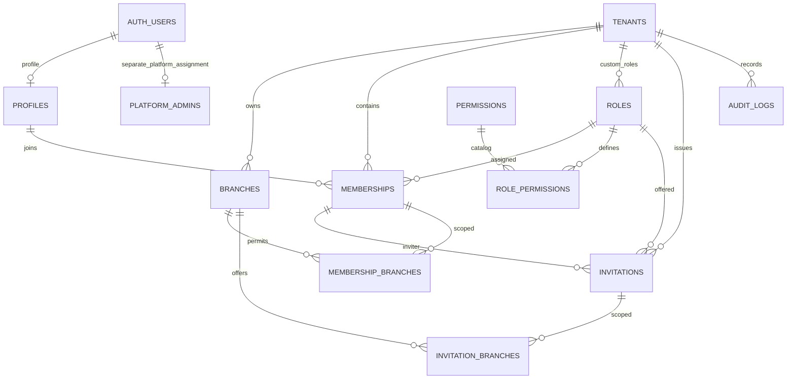

# M1 P1 — Database Foundation: migration review v2

**Status: final SQL draft presented for review; NOT applied.** Target only the dedicated Dev Supabase project `ojozmvvdpjmvsxmpgrul`. P2 is not approved. GitHub synchronization was confirmed **Connected and active by the user**, not independently checked by the agent.

The complete proposed migration is `database-foundation.review.sql`. It is a review document, not a migration installed under `supabase/migrations`. After the user approves these exact contents, the migration tool will apply them and manage the version-controlled migration file.

## Current read-only preflight
- Connected project configuration matches the dedicated Dev project.
- Live database read returned **zero public tables**.
- Fresh read-only Dev preflight: citext is **not installed** (installed count 0, schema/type NULL); `extensions` exists; citext **1.6** is available. Install statement proposes `extensions.citext`. A pre-install guard fails if a concurrent/later install uses another schema; it does not relocate extensions. Re-run preflight before execution.
- Read-only role inspection: service_role is non-superuser, has BYPASSRLS, and has no inherited roles; authenticated/anon are non-superuser without BYPASSRLS or inherited roles. Future table ownership/ACLs still require post-application verification.
- No database changes, Auth settings changes, account grants or application changes performed.

## Objects proposed
**5 enums:** tenant_status, record_status, membership_status, invitation_status, role_scope.

**12 tables:**
| Table | Foundation |
|---|---|
| tenants | UUID PK, unique case-insensitive slug and creation_key, organization settings/status, reserved Owner counter |
| branches | Tenant FK, unique tenant/code and tenant/id, contact/address/timezone/status |
| profiles | Auth UUID PK/FK, Light/Dark preference, last tenant hint; no signup trigger yet |
| roles | System or tenant roles, immutable semantics, tenant/key uniqueness plus NULL-tenant partial global-key uniqueness |
| permissions | Controlled global permission-key catalog |
| role_permissions | Role/permission FKs, composite PK |
| memberships | Tenant/profile/role FKs, unique tenant/user and tenant/id; immutable identity |
| membership_branches | Composite membership+tenant and branch+tenant FKs; pair PK |
| invitations | Tenant/role FKs; canonical same-tenant inviter_membership_id FK; no redundant invited_by; hash/pending-email uniqueness; acceptance fields |
| invitation_branches | Composite invitation+tenant and branch+tenant FKs; pair PK; no UUID array |
| audit_logs | Identity PK, tenant FK, actor/event metadata; no client writes |
| platform_admins | Separate Auth UUID authorization table; empty in P1 |

**Constraints:** NOT NULL on required identity/endpoints; all declared PK/FK/unique constraints; membership-profile deletion RESTRICT; immutable identity triggers; same-tenant/global-role validation triggers with explicit NULL handling. Validation triggers check slug/name, timezone existence, code/currency formatting, role scope/rank, exactly Light/Dark, invitation hash and acceptance consistency. Country/currency checks validate code format, not authoritative ISO catalog membership; comprehensive lookup validation remains an explicit follow-up before onboarding is enabled.

**Explicit indexes:** two partial unique indexes (`roles_system_key_unique`, `invitations_pending_email_unique`) and sixteen supporting indexes for tenant/status, user/tenant/status, FK traversal, branch/invitation joins and audit timelines. PK and UNIQUE constraints also create their own backing indexes.

**Functions:** four non-callable structural trigger routines: identity guard, field validation, same-tenant role validation and updated_at maintenance. Only role validation is SECURITY DEFINER, with fixed empty search_path and qualified role read. No authenticated EXECUTE grants or authorization RPCs.

**Catalog inserts only:** 5 approved system roles, 14 permission definitions and 37 role-permission mappings matching the approved matrix. branch.delete and role.manage are reserved catalog capabilities, not enabled features. No organizations, branches, users, profiles, memberships, invitations, platform admins or business statistics are seeded.

## P1 deny-by-default boundary
Each CREATE TABLE is followed by explicit privileges, then RLS enablement. Revoke default PUBLIC/anon/authenticated grants before granting authenticated SELECT only; no policies means SELECT returns no rows. Invitations grant SELECT only on safe columns, never token_hash. No authenticated INSERT/UPDATE/DELETE/TRUNCATE grants. service_role receives ONLY a safe tenant SELECT projection and audit SELECT; no direct writes, other table privileges, sequence privileges or callable trigger-function grants. No service credentials appear in the draft or frontend.

SELECT grant does **not** activate catalog visibility; P2 supplies isolated policies. P1 is not a usable tenant system. The service credential cannot directly create business data under this grant plan. A database owner/operator remains trusted and can administer the database; never claim ACLs constrain the owner. Future P2/P3 security-definer routines execute under a trusted function owner and need explicit authorization; they do not require service_role DML grants.

## Explicitly deferred; not implemented or tested
- P2: permission/membership helpers, tenant/custom-role policies, branch authority checks, database audit writers/guards, atomic Owner counter synchronization and minimum-one invariant. `active_owner_count` is storage only in P1, not security enforcement.
- P3: atomic onboarding, retry ownership validation, invitation create/accept/revoke, token expiry-at-use, continuing inviter authority and rank restrictions.
- P2/P4: profile auto-creation, verified-email signup and account recovery.
- P9: **logicaltechzoneofficial@gmail.com** resolved to a verified authenticated UUID via controlled bootstrap; no grant now. Platform authorization is entirely separate from tenant roles.
- Final security testing: independent-session Owner races, direct JWT/API restrictions, unauthorized service-role calls and deployed secret isolation.

## ERD

## Checks actually performed
**Passed:** PostgreSQL outer SQL grammar parsing (122 statements); static structure checks: 12 tables, 12 RLS enablements, grants after creation, zero policies, no authenticated DML grants, and only three catalog-seeding INSERT statements. Updated checks also assert exactly two narrow service SELECT grants, no write/sequence/function grants, four function revocations including service_role, canonical inviter FK, deletion FK chain and citext guard. A parser does not validate PL/pgSQL bodies or database behavior.

**Not run:** migration execution, trigger compilation/runtime, FK/uniqueness rejection, live RLS/API denials, concurrency, invitation authority, Auth flows, platform authorization or deployed bundle inspection. No P1 database test is marked passed.

## After approval of this SQL
Apply via migration tool to Dev only. Then verify live tables, enums, constraints/indexes, seed counts, grants, RLS/no-policy state and function security settings; run structural positive/negative tests using rollback-only fixtures and provide actual results with schema and ERD. Report failures honestly. Stop after P1 and wait for P1 review and explicit P2 approval.
## Every service-role privilege: rationale
v1 granted ALL to eleven tables: tenants, branches, profiles, roles, permissions, role_permissions, memberships, membership_branches, invitations, invitation_branches and platform_admins. That included unnecessary INSERT, UPDATE, DELETE, TRUNCATE, REFERENCES and TRIGGER privileges; these are all removed. v1 audit INSERT and sequence USAGE/SELECT are also removed.

| Table/object | v2 service_role grants | Why / intended path |
|---|---|---|
| tenants | SELECT only id, name, slug, country, timezone, default_currency, contact_email, contact_phone, status, created_at, updated_at | Future explicitly authorized platform list/detail; omit settings, creator, idempotency key, internal Owner counter. These reads bypass RLS and must still be server-authorized when used. No status/other direct UPDATE; future reviewed restricted routine. |
| branches | None | Ordinary JWT/RLS operations; no platform branch surface in P1. |
| profiles | None | Self-scoped JWT access and future trusted signup trigger, not service direct writes. |
| roles | None | Migration-controlled system catalogs; future JWT/helper read paths. |
| permissions | None | Migration-controlled catalog, not service-managed. |
| role_permissions | None | Migration-controlled mappings, isolated future JWT policies. |
| memberships | None | Checked atomic RPCs under trusted database routine owner, called with user JWT. |
| membership_branches | None | Same authorized membership RPC, not direct privileged grants. |
| invitations | None | Future user-JWT invitation RPCs; no service token-hash reads/writes. |
| invitation_branches | None | Future checked invitation RPCs. |
| audit_logs | SELECT only | Future authorized platform audit review. Writes occur only through reviewed database-controlled paths with explicit actor attribution; no direct service INSERT/UPDATE/DELETE. |
| platform_admins | None | User-scoped platform verification helper; trusted operator-owned bootstrap/grant process in P9. No service table write path for tenant promotion. |
| audit identity sequence | None | No service inserts; reads require no sequence access. |
| four trigger functions | None (explicit EXECUTE revocation) | Trigger-only integrity routines; no API call grant. |

Each new table explicitly revokes default privileges from PUBLIC, anon, authenticated **and service_role** before narrow grants. No ALTER DEFAULT PRIVILEGES on unrelated objects, no ownership grants, no role membership changes. P1 service reads are reserved for future reviewed administration; no server functions are added now. Revoking EXECUTE after trigger creation does not stop installed triggers firing; future function/table owner permissions must be verified. Exactly one definer trigger performs a fixed, qualified role read with a lock; it returns only NEW or an integrity error, contains no dynamic SQL and supplies no authorization bypass endpoint. It enforces structural role integrity, not caller permission.

## Actor identity integrity
- **invitations:** remove invited_by from table, safe SELECT grant and immutable-identity guard. The canonical inviter is inviter_membership_id. Composite FK proves matching tenant; immutable membership.user_id determines the inviter user. No pair of independently stored inviter identities can disagree. Future creation derives this membership from the verified caller; P1 does not prove caller authority or current invitation permission.
- **tenants.created_by:** keep immutable historical UUID, intentionally without Auth FK to preserve provenance and avoid attaching application history to Auth lifecycle. This field never grants authority. P1 has no provisioning API or client INSERT permission; only future create_organization may populate it from verified auth.uid(), with same-creator idempotent retry checks. This provenance guarantee is deferred, not falsely claimed enforced now.
- **memberships.invited_by:** retained as historical provenance (not used to authorize or join grants), and documented accordingly. Future acceptance derives it from canonical inviter membership, never submitted identity. Audit actor UUIDs follow the same rule.

## Account deletion and offboarding contract
1. An Auth hard delete requests cascade deletion of profiles and platform_admins. If **any** membership references that profile, memberships.user_id ON DELETE RESTRICT rejects the profile delete and the **entire Auth delete transaction rolls back**, including any platform-admin cascade. RLS/soft status does not alter FK behavior: active, invited, suspended and removed rows all block it.
2. M1 organization offboarding means a future permission-checked status transition to suspended/removed, branch grant cleanup/revocation and pending-invitation revocation under the approved locks, with audit history retained. It removes tenant access, not the authentication account or another tenant's membership. Last active Owner protection is still P2, not installed here.
3. A user with retained memberships cannot self-hard-delete or be hard-deleted by an operator just by marking memberships removed. M1 has no account deletion feature. An account with no referencing memberships can be deleted through the existing trusted Auth administrative lifecycle; profile/platform assignment cascade, historical plain UUIDs remain. P1 performs no deletion or Auth changes.
4. Future hard deletion/erasure requires a separately approved retention/purge or anonymization design: preserve/replace effective Owners across all tenants, handle branch and invitation FKs/history, platform access and privacy obligations, then decide whether to remove referencing rows or redesign retained identity references. No cascade weakening, FK removal, forced purge or blank identity substitution in P1. Membership removal alone must never be represented as complete account erasure.

## Exact revision inventory
1. Extend all twelve table, four function and one sequence revocations to include service_role.
2. Remove eleven GRANT ALL statements; add safe-column tenant service SELECT only.
3. Audit SELECT/INSERT becomes SELECT only; remove sequence USAGE/SELECT.
4. Remove invitations.invited_by from its column definition, safe grant and identity guard; preserve canonical same-tenant inviter membership FK.
5. Add citext installed-schema fail-fast guard and migration-local schema resolution after install; no automatic relocation.
6. Add SQL lifecycle/provenance/privilege comments and column/table comments; clarify RLS applies to authenticated reads, not service-role reads.
7. Preserve all twelve tables, five enums, role/tenant integrity checks, sixteen supporting/two partial indexes, system seed values and zero-policy/no-application scope.
8. Add retained executable static-check script and versioned complete SQL, schema, exact unified SQL diff and checks report. No P2, Auth or application code added.
