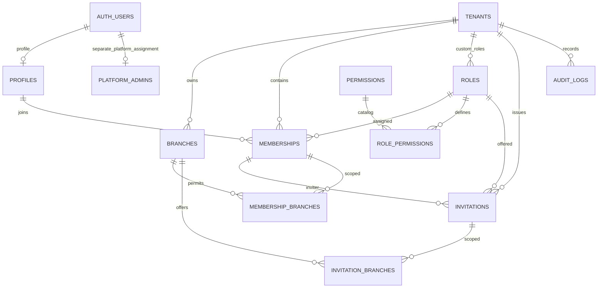

# M1 P1 — Database Foundation: migration review v3

**Status: final SQL draft presented for review; NOT applied.** Target only the dedicated Dev Supabase project `ojozmvvdpjmvsxmpgrul`. P2 is not approved. GitHub synchronization was confirmed **Connected and active by the user**, not independently checked by the agent.

The complete proposed migration is `database-foundation.review.sql`. It is a review document, not a migration installed under `supabase/migrations`. After the user approves these exact contents, the migration tool will apply them and manage the version-controlled migration file.

## Prior read-only preflight (V2; not repeated for V3)
- Connected project configuration matches the dedicated Dev project.
- Live database read returned **zero public tables**.
- V2 read-only Dev preflight: citext is **not installed** (installed count 0, schema/type NULL); `extensions` exists; citext **1.6** is available. Install statement proposes `extensions.citext`. A pre-install guard fails if a concurrent/later install uses another schema; it does not relocate extensions. Re-run preflight before execution.
- Read-only role inspection: service_role is non-superuser, has BYPASSRLS, and has no inherited roles; authenticated/anon are non-superuser without BYPASSRLS or inherited roles. Future table ownership/ACLs still require post-application verification.
- No database changes, Auth settings changes, account grants or application changes performed. V3 uses offline checks only and makes no database requests; these historical observations are not fresh live-state verification.

## Objects proposed
**5 enums:** tenant_status, record_status, membership_status, invitation_status, role_scope.

**12 tables:**
| Table | Foundation |
|---|---|
| tenants | UUID PK, unique case-insensitive slug and creation_key, organization settings/status, reserved Owner counter |
| branches | Tenant FK, unique tenant/code and tenant/id, contact/address/timezone/status |
| profiles | Auth UUID PK/FK, Light/Dark preference, last tenant hint; no signup trigger yet |
| roles | System or tenant roles, immutable semantics, tenant/key uniqueness plus NULL-tenant partial global-key uniqueness |
| permissions | Controlled global permission-key catalog |
| role_permissions | Role/permission FKs, composite PK |
| memberships | Tenant/profile/role FKs, unique tenant/user and tenant/id; immutable identity |
| membership_branches | Composite membership+tenant and branch+tenant FKs; pair PK |
| invitations | Tenant/role FKs; canonical same-tenant inviter_membership_id FK; no redundant invited_by; hash/pending-email uniqueness; acceptance fields |
| invitation_branches | Composite invitation+tenant and branch+tenant FKs; pair PK; no UUID array |
| audit_logs | Identity PK, tenant FK, actor/event metadata; no client writes |
| platform_admins | Separate Auth UUID authorization table; empty in P1 |

**Constraints:** NOT NULL on required identity/endpoints; all declared PK/FK/unique constraints; membership-profile deletion RESTRICT; immutable identity triggers; same-tenant/global-role validation triggers with explicit NULL handling. Validation triggers check slug/name, timezone existence, code/currency formatting, role scope/rank, exactly Light/Dark, invitation hash and acceptance consistency. Country/currency checks validate code format, not authoritative ISO catalog membership; comprehensive lookup validation remains an explicit follow-up before onboarding is enabled.

**Explicit indexes:** two partial unique indexes (`roles_system_key_unique`, `invitations_pending_email_unique`) and sixteen supporting indexes for tenant/status, user/tenant/status, FK traversal, branch/invitation joins and audit timelines. PK and UNIQUE constraints also create their own backing indexes.

**Functions:** four non-callable structural trigger routines: identity guard, field validation, same-tenant role validation and updated_at maintenance. Only role validation is SECURITY DEFINER, with fixed empty search_path and qualified role read. No authenticated EXECUTE grants or authorization RPCs.

**Catalog inserts only:** 5 approved system roles, 14 permission definitions and 37 role-permission mappings matching the approved matrix. branch.delete and role.manage are reserved catalog capabilities, not enabled features. No organizations, branches, users, profiles, memberships, invitations, platform admins or business statistics are seeded.

## P1 deny-by-default boundary
Each CREATE TABLE is followed by explicit privileges, then RLS enablement. Revoke default PUBLIC/anon/authenticated grants before granting authenticated SELECT only; no policies means SELECT returns no rows. Invitations grant SELECT only on safe columns, never token_hash. No authenticated INSERT/UPDATE/DELETE/TRUNCATE grants. service_role receives NO direct table or column privileges, including SELECT, and no sequence privileges or callable trigger-function grants. Both V2 service SELECT grants have been removed; any necessary platform access requires separately reviewed P9 authorization. No service credentials appear in the draft or frontend.

SELECT grant does **not** activate catalog visibility; P2 supplies isolated policies. P1 is not a usable tenant system. The service credential has no direct read or write privilege on any P1 table or the audit identity sequence under this grant plan; BYPASSRLS does not itself grant object access. A database owner/operator remains trusted and can administer the database; never claim ACLs constrain the owner. Future P2/P3 security-definer routines execute under a trusted function owner and need explicit authorization; they do not require service_role DML grants.

## Explicitly deferred; not implemented or tested
- P2: permission/membership helpers, tenant/custom-role policies, branch authority checks, database audit writers/guards, atomic Owner counter synchronization and minimum-one invariant. `active_owner_count` is storage only in P1, not security enforcement.
- P3: atomic onboarding, retry ownership validation, invitation create/accept/revoke, token expiry-at-use, continuing inviter authority and rank restrictions.
- P2/P4: profile auto-creation, verified-email signup and account recovery.
- P9: **logicaltechzoneofficial@gmail.com** resolved to a verified authenticated UUID via controlled bootstrap; no grant now. Platform authorization is entirely separate from tenant roles.
- Final security testing: independent-session Owner races, direct JWT/API restrictions, unauthorized service-role calls and deployed secret isolation.

## ERD

## Checks actually performed
**Passed (V3, offline):** PostgreSQL outer SQL grammar parsing (120 statements); structured GRANT checks enforce exactly twelve authenticated SELECT grants, zero service_role grants, no grant option and no sequence/function grants. All twelve tables have explicit client/service revocations followed by authenticated SELECT then RLS enablement; zero policy definitions. Invitation projection excludes token_hash. The audit identity sequence and all four trigger functions explicitly revoke service_role access. No ownership, role membership or default privilege changes. Sixteen supporting indexes, two partial unique indexes, canonical inviter FK, deletion chain, citext guard and only three catalog INSERT statements remain.

**Regression checks passed:** five offline tests cover the valid 120-statement draft, forbidden service table/column/audit/sequence privileges, authenticated INSERT/UPDATE/DELETE/TRUNCATE, removal of any required RLS enablement (sample mutation: tenants), and addition of a policy. The preserved V2 SQL fails the new zero-service-grants check as expected. This is a deliberate negative test, not a failed V3 check. The first attempt to run the prior checker lacked pglast in this session; installing the parser under /tmp resolved it, and the baseline and revised checks then ran successfully. Parser checks do not compile PL/pgSQL or prove live behavior.
**Not run:** migration execution, trigger compilation/runtime, FK/uniqueness rejection, live RLS/API denials, concurrency, invitation authority, Auth flows, platform authorization or deployed bundle inspection. No P1 database test is marked passed.

## After approval of this SQL
Apply via migration tool to Dev only. Then verify live tables, enums, constraints/indexes, seed counts, grants, RLS/no-policy state and function security settings; run structural positive/negative tests using rollback-only fixtures and provide actual results with schema and ERD. Report failures honestly. Stop after P1 and wait for P1 review and explicit P2 approval.
## Service-role privilege review — V3
**None granted on any P1 table, column or sequence.** P1 has no application or platform administration functionality requiring privileged reads. service_role BYPASSRLS would allow cross-tenant reads if object SELECT were granted, so both V2 read grants are removed rather than relying on future callers to authorize them.

| Object | V3 service_role privileges | Intended future path, not implemented in P1 |
|---|---|---|
| tenants | None; restricted-column SELECT removed | Separately reviewed P9 platform authorization and narrow access design |
| audit_logs | None; SELECT removed | Separately reviewed P9 platform audit authorization; P2 database-controlled writers |
| branches, profiles | None | Ordinary authenticated JWT/RLS access or reviewed lifecycle routines |
| roles, permissions, role_permissions | None | Migration-controlled catalogs; isolated authenticated read paths |
| memberships, membership_branches | None | Reviewed, authenticated, atomic membership routines |
| invitations, invitation_branches | None | Reviewed user-JWT invitation routines; no service token-hash access |
| platform_admins | None | Controlled verified-account bootstrap and platform authorization in P9 |
| audit_logs_id_seq | None; explicit REVOKE ALL retained | No service inserts; no sequence access needed |
| all four trigger functions | None; explicit EXECUTE revocations retained | Installed integrity triggers only, not callable RPC endpoints |

All twelve tables revoke ALL from PUBLIC, anon, authenticated and service_role before granting authenticated SELECT only. V3 contains no service_role GRANT of any kind. No ALTER DEFAULT PRIVILEGES on unrelated objects, ownership grants or role membership changes. Database owners/operators remain trusted; the draft cannot constrain object owners. Effective ACL, column privilege, sequence privilege and role-inheritance checks must still be performed after separately approved execution. No live denial test is claimed here.

Exactly one SECURITY DEFINER trigger performs a fixed, qualified role read with a row-share lock; it returns only NEW or an integrity error, contains no dynamic SQL and exposes no callable authorization bypass. All four functions fix search_path to empty and explicitly revoke EXECUTE from PUBLIC, anon, authenticated and service_role. This enforces role structure, not caller permission. Function ownership and installed trigger behavior remain untested until approved application.

## Actor identity integrity
- **invitations:** remove invited_by from table, safe SELECT grant and immutable-identity guard. The canonical inviter is inviter_membership_id. Composite FK proves matching tenant; immutable membership.user_id determines the inviter user. No pair of independently stored inviter identities can disagree. Future creation derives this membership from the verified caller; P1 does not prove caller authority or current invitation permission.
- **tenants.created_by:** keep immutable historical UUID, intentionally without Auth FK to preserve provenance and avoid attaching application history to Auth lifecycle. This field never grants authority. P1 has no provisioning API or client INSERT permission; only future create_organization may populate it from verified auth.uid(), with same-creator idempotent retry checks. This provenance guarantee is deferred, not falsely claimed enforced now.
- **memberships.invited_by:** retained as historical provenance (not used to authorize or join grants), and documented accordingly. Future acceptance derives it from canonical inviter membership, never submitted identity. Audit actor UUIDs follow the same rule.

## Account deletion and offboarding contract
1. An Auth hard delete requests cascade deletion of profiles and platform_admins. If **any** membership references that profile, memberships.user_id ON DELETE RESTRICT rejects the profile delete and the **entire Auth delete transaction rolls back**, including any platform-admin cascade. RLS/soft status does not alter FK behavior: active, invited, suspended and removed rows all block it.
2. M1 organization offboarding means a future permission-checked status transition to suspended/removed, branch grant cleanup/revocation and pending-invitation revocation under the approved locks, with audit history retained. It removes tenant access, not the authentication account or another tenant's membership. Last active Owner protection is still P2, not installed here.
3. A user with retained memberships cannot self-hard-delete or be hard-deleted by an operator just by marking memberships removed. M1 has no account deletion feature. An account with no referencing memberships can be deleted through the existing trusted Auth administrative lifecycle; profile/platform assignment cascade, historical plain UUIDs remain. P1 performs no deletion or Auth changes.
4. Future hard deletion/erasure requires a separately approved retention/purge or anonymization design: preserve/replace effective Owners across all tenants, handle branch and invitation FKs/history, platform access and privacy obligations, then decide whether to remove referencing rows or redesign retained identity references. No cascade weakening, FK removal, forced purge or blank identity substitution in P1. Membership removal alone must never be represented as complete account erasure.

## Exact revision inventory
### V2 → V3 (this review)
1. Delete the complete tenant column-projection service_role SELECT grant and its future-platform-listing comment.
2. Delete audit_logs service_role SELECT and its future-platform-audit comment.
3. Update the SQL version/header, privilege boundary comments and audit_logs table COMMENT to state zero service privileges and separate P9 review.
4. Preserve twelve table REVOKE ALL statements including service_role, the audit sequence revocation, all four function revocations and all twelve authenticated SELECT grants.
5. Replace the checker’s two-service-grants expectation with structured parser checks rejecting every service grant, non-SELECT authenticated grant, grant option, non-table grant, role membership/ownership/default-privilege changes. Retain structural checks and add five offline regression tests.
6. No schema, enum, column, constraint, index, trigger body, catalog seed or Auth changes from V2. SQL statement count falls from 122 to 120 solely by removing two grants.
7. Reproduce the actual unified V1 → V2 diff from the preserved original SQL files and provide it together with V2 → V3 and V1 → V3 in a readable plain-text exact-diff attachment. Include source SHA-256 hashes and line/byte counts; preserve the original V1/V2 attachments.

### V1 → V2 (historical; full diff supplied)
1. Extend all twelve table, four function and one sequence revocations to include service_role.
2. Remove eleven GRANT ALL statements; replace tenant ALL with safe-column SELECT (now removed in V3).
3. Replace audit SELECT/INSERT with SELECT (now removed in V3); remove sequence USAGE/SELECT.
4. Remove invitations.invited_by from its definition, authenticated projection and identity guard; keep canonical same-tenant inviter membership FK.
5. Add citext installed-schema fail-fast guard and migration-local schema resolution; no extension relocation.
6. Add SQL lifecycle/provenance/privilege comments and column/table comments. Preserve twelve tables, five enums, integrity checks, supporting/partial indexes and catalog seed values.

## Final confirmation (draft scope)
- No service_role direct table, column or sequence privileges remain in V3; explicit revocations cover all twelve tables and the one generated identity sequence.
- No authenticated INSERT, UPDATE, DELETE or TRUNCATE grants exist; authenticated grants are SELECT only, with no policies.
- All twelve tables retain RLS enabled with zero policies; authenticated SELECT therefore has no policy-authorized rows.
- No P2, Auth, application or applied migration changes introduced. No SQL submitted or executed against Dev for this revision.
- Execution remains pending separate explicit approval of this exact V3 SQL. Live effective privileges and all database/runtime security tests remain unexecuted.
