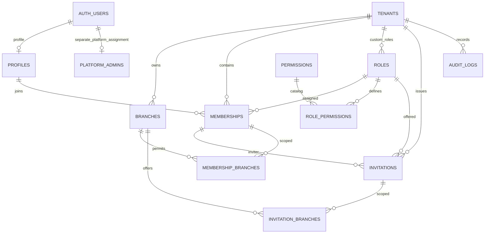

# M1 P1 — Database Foundation: migration review

**Status: final SQL draft presented for review; NOT applied.** Target only the dedicated Dev Supabase project `ojozmvvdpjmvsxmpgrul`. P2 is not approved. GitHub synchronization was confirmed **Connected and active by the user**, not independently checked by the agent.

The complete proposed migration is `database-foundation.review.sql`. It is a review document, not a migration installed under `supabase/migrations`. After the user approves these exact contents, the migration tool will apply them and manage the version-controlled migration file.

## Current read-only preflight
- Connected project configuration matches the dedicated Dev project.
- Live database read returned **zero public tables**.
- `pgcrypto` is installed in `extensions`; SQL proposes `citext` in `extensions`.
- No database changes, Auth settings changes, account grants or application changes performed.

## Objects proposed
**5 enums:** tenant_status, record_status, membership_status, invitation_status, role_scope.

**12 tables:**
| Table | Foundation |
|---|---|
| tenants | UUID PK, unique case-insensitive slug and creation_key, organization settings/status, reserved Owner counter |
| branches | Tenant FK, unique tenant/code and tenant/id, contact/address/timezone/status |
| profiles | Auth UUID PK/FK, Light/Dark preference, last tenant hint; no signup trigger yet |
| roles | System or tenant roles, immutable semantics, tenant/key uniqueness plus NULL-tenant partial global-key uniqueness |
| permissions | Controlled global permission-key catalog |
| role_permissions | Role/permission FKs, composite PK |
| memberships | Tenant/profile/role FKs, unique tenant/user and tenant/id; immutable identity |
| membership_branches | Composite membership+tenant and branch+tenant FKs; pair PK |
| invitations | Tenant/role FKs; composite inviter membership FK; hash uniqueness; pending tenant/email partial uniqueness; acceptance fields |
| invitation_branches | Composite invitation+tenant and branch+tenant FKs; pair PK; no UUID array |
| audit_logs | Identity PK, tenant FK, actor/event metadata; no client writes |
| platform_admins | Separate Auth UUID authorization table; empty in P1 |

**Constraints:** NOT NULL on required identity/endpoints; all declared PK/FK/unique constraints; membership-profile deletion RESTRICT; immutable identity triggers; same-tenant/global-role validation triggers with explicit NULL handling. Validation triggers check slug/name, timezone existence, code/currency formatting, role scope/rank, exactly Light/Dark, invitation hash and acceptance consistency. Country/currency checks validate code format, not authoritative ISO catalog membership; comprehensive lookup validation remains an explicit follow-up before onboarding is enabled.

**Explicit indexes:** two partial unique indexes (`roles_system_key_unique`, `invitations_pending_email_unique`) and sixteen supporting indexes for tenant/status, user/tenant/status, FK traversal, branch/invitation joins and audit timelines. PK and UNIQUE constraints also create their own backing indexes.

**Functions:** four non-callable structural trigger routines: identity guard, field validation, same-tenant role validation and updated_at maintenance. Only role validation is SECURITY DEFINER, with fixed empty search_path and qualified role read. No authenticated EXECUTE grants or authorization RPCs.

**Catalog inserts only:** 5 approved system roles, 14 permission definitions and 37 role-permission mappings matching the approved matrix. branch.delete and role.manage are reserved catalog capabilities, not enabled features. No organizations, branches, users, profiles, memberships, invitations, platform admins or business statistics are seeded.

## P1 deny-by-default boundary
Each CREATE TABLE is followed by explicit privileges, then RLS enablement. Revoke default PUBLIC/anon/authenticated grants before granting authenticated SELECT only; no policies means SELECT returns no rows. Invitations grant SELECT only on safe columns, never token_hash. No authenticated INSERT/UPDATE/DELETE/TRUNCATE grants. service_role has required internal privileges, with audit access limited to SELECT/INSERT and sequence usage. No service credentials appear in the draft or frontend.

SELECT grant does **not** activate catalog visibility; P2 supplies isolated policies. P1 is not a usable tenant system. Trusted operator/service access remains privileged and must not create business data before P2/P3.

## Explicitly deferred; not implemented or tested
- P2: permission/membership helpers, tenant/custom-role policies, branch authority checks, database audit writers/guards, atomic Owner counter synchronization and minimum-one invariant. `active_owner_count` is storage only in P1, not security enforcement.
- P3: atomic onboarding, retry ownership validation, invitation create/accept/revoke, token expiry-at-use, continuing inviter authority and rank restrictions.
- P2/P4: profile auto-creation, verified-email signup and account recovery.
- P9: **logicaltechzoneofficial@gmail.com** resolved to a verified authenticated UUID via controlled bootstrap; no grant now. Platform authorization is entirely separate from tenant roles.
- Final security testing: independent-session Owner races, direct JWT/API restrictions, unauthorized service-role calls and deployed secret isolation.

## ERD

## Checks actually performed
**Passed:** PostgreSQL outer SQL grammar parsing (127 statements); static structure checks: 12 tables, 12 RLS enablements, grants after creation, zero policies, no authenticated DML grants, and only three catalog-seeding INSERT statements. A parser does not validate PL/pgSQL bodies or database behavior.

**Not run:** migration execution, trigger compilation/runtime, FK/uniqueness rejection, live RLS/API denials, concurrency, invitation authority, Auth flows, platform authorization or deployed bundle inspection. No P1 database test is marked passed.

## After approval of this SQL
Apply via migration tool to Dev only. Then verify live tables, enums, constraints/indexes, seed counts, grants, RLS/no-policy state and function security settings; run structural positive/negative tests using rollback-only fixtures and provide actual results with schema and ERD. Report failures honestly. Stop after P1 and wait for P1 review and explicit P2 approval.